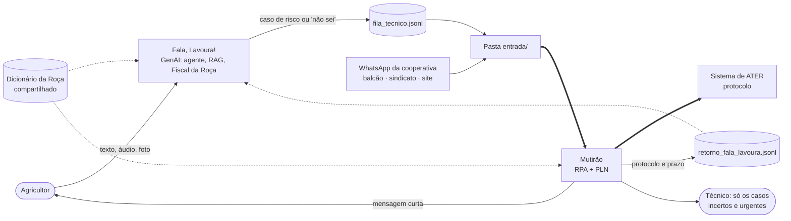
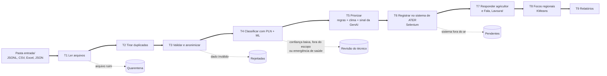

# Mutirão: o robô que leva cada pedido do campo até o técnico

**Global Solution 2026.2 | AI for Robotic Process Automation | Tema CitizenTech · Agricultura familiar**

O Mutirão é o back-office do **Fala, Lavoura!**, o projeto de IA generativa do grupo. O Fala, Lavoura! conversa com o agricultor e, quando o caso pede uma pessoa, manda uma ficha para a fila do técnico. O Mutirão pega essa fila e os pedidos que chegam pelos outros canais (cooperativa, balcão da Casa da Agricultura, sindicato rural e site). Ele classifica cada pedido com PLN, define a prioridade com a previsão do tempo, registra no sistema de ATER com protocolo e devolve a resposta ao agricultor e ao próprio Fala, Lavoura!. Quando não tem certeza, ou quando é uma emergência de saúde, o pedido vai para um técnico.

## Integrantes

Nome | RM | Contribuição
Claudio Alves de Carvalho Junior | RM568565 | Desenvolvimento do robô e documentação
Gustavo Duarte | RM567066 | Revisão do conjunto de teste e da avaliação
Leonardo Pereira dos Santos | RM567836 | Revisão do gabarito e dos casos de falha

## O problema

Só cerca de um em cada cinco estabelecimentos rurais do Brasil diz ter recebido orientação técnica (IBGE, Censo Agropecuário 2017), e quase 77% deles são de agricultura familiar. Do lado da assistência técnica e extensão rural (ATER), o gargalo é a triagem. Os pedidos chegam pelo WhatsApp da cooperativa, pelo balcão da Casa da Agricultura, pela planilha do sindicato e pelo site, cada canal num formato. Um técnico lê tudo, decide o assunto e a urgência de olho e digita um por um num sistema antigo. Nesse tempo ele não está no campo. Uma intoxicação por agrotóxico ou uma geada chegando ficam na mesma fila de uma dúvida sobre adubo.

**Público:** agricultores familiares que pedem assistência técnica e técnicos de extensão rural (Casa da Agricultura, Emater, cooperativas).

## Como o Mutirão completa o Fala, Lavoura!



| O que o Fala, Lavoura! (GenAI) faz | O que o Mutirão (RPA + PLN) faz |
| :- | :- |
| Conversa com o agricultor e responde dúvidas do dia a dia | Organiza o trabalho do técnico quando a conversa não basta |
| Manda para a fila do técnico o que não deve responder sozinho | Lê essa fila (JSONL) junto com os outros canais e transforma cada ficha em protocolo |
| Marca cada resposta com o semáforo do Fiscal da Roça | Usa o semáforo vermelho e a "emergência" apontada pela IA como critérios de prioridade |
| Usa o Dicionário da Roça para buscar nas fichas técnicas | Usa o mesmo dicionário para classificar o texto do agricultor (+3,7 pontos de acurácia) |
| Já anonimiza a ficha antes de gravar | Confere de novo e mascara CPF, telefone e e-mail de todos os canais |
| Fica com o status "aguardando técnico" | Devolve protocolo, prioridade, equipe e prazo em `retorno_fala_lavoura.jsonl` |

Um sem o outro não fecha o ciclo: sem o Mutirão, a ficha do Fala, Lavoura! fica parada num arquivo; sem o Fala, Lavoura!, o Mutirão só recebe o que chega pelos canais antigos. Detalhes em [docs/integracao_fala_lavoura.md](docs/integracao_fala_lavoura.md).

**E a GS de PLN (Fábrica de Corpus)?** Ela fecha a terceira ponta do mesmo problema: transforma os documentos oficiais do Pronaf, Garantia-Safra, CAF e ATER em corpus para treinar um modelo pequeno que roda sem internet. No Mutirão, os pedidos classificados como "crédito e programas públicos" são justamente os que esse modelo responderia; hoje eles seguem para o técnico com protocolo. As três entregas usam dados públicos ou sintéticos e mascaram dados pessoais antes de qualquer processamento.

## Como funciona



As linhas pontilhadas são os caminhos seguros: cada falha vai para uma fila própria, com o motivo registrado, e o restante segue. O sistema de ATER é um portal web simulado (`portal/`), com login e formulário, que sobe junto com o robô. Automatizar um sistema público real com dados sintéticos geraria protocolos falsos, por isso ele é simulado.

**Assuntos que o robô reconhece:** pragas, doenças, água e irrigação, solo e adubação, crédito e programas públicos (Pronaf, CAF, Garantia-Safra, PAA, PNAE). Um sexto rótulo, "outros", reconhece o que não é assistência técnica (estrada, energia, documento pessoal) e manda para um técnico encaminhar ao órgão certo.

**Prioridade explicável:** peso do assunto, palavras de risco (intoxicação, criança exposta, veneno perto de água, família sem água para beber, lavoura inteira se perdendo), semáforo vermelho do Fala, Lavoura!, pedido repetido, prazo de programa correndo e a previsão dos próximos 3 dias no centro do município (geada, calor sem chuva para pedidos de água, chuva acumulada que favorece fungo para pedidos de doença). Toda prioridade vem com uma justificativa em texto.

## Quadro de temas

Detalhamento e temas descartados em [docs/quadro_de_temas.md](docs/quadro_de_temas.md).

| Tema | Onde no fluxo | O que resolve | Por que escolhemos |
| :- | :- | :- | :- |
| **1. Automação web com Selenium** | T6, [src/rpa_portal.py](src/rpa_portal.py) | Faz login no sistema de ATER e cadastra cada pedido, com espera explícita, retry e print da tela em caso de erro. Usa o Edge se o Chrome não abrir. | Sistemas públicos antigos raramente têm API. Selenium localiza os campos pela página, sem depender de coordenadas da tela como o PyAutoGUI. |
| **2. Arquivos e I/O** (encoding, chunking, JSONL linha a linha, watchdog) | T1, [src/leitura.py](src/leitura.py) e modo `vigiar` | Lê a fila do Fala, Lavoura! em JSONL, CSV em UTF-8 e em CP1252, Excel e JSON. Uma linha quebrada no JSONL é pulada sem perder as outras; um arquivo corrompido vai para quarentena. | Cada canal grava num formato diferente. Sem esse tratamento, "Feijão" vira "Feijão" ou a leitura quebra. |
| **3. Automação de Excel** (pandas + calamine, XlsxWriter) | T1 e T9, [src/relatorio.py](src/relatorio.py) | Lê a planilha do sindicato e gera o relatório da Casa da Agricultura, com abas por situação, cores por prioridade, filtros, gráfico e focos regionais. | A ATER trabalha com Excel. Calamine lê rápido e XlsxWriter permite formatação e gráficos. |
| **4. Tratamento de erros e logs** | Todo o fluxo, [src/resiliencia.py](src/resiliencia.py) | Timeout, retry com espera exponencial, disjuntor, pendentes, quarentena, idempotência e log de cada tarefa. | API, sistema e arquivos falham na prática, e internet no campo é instável. Cada falha previsível precisa de um caminho seguro. |
| **5. RPA + IA/PLN** (Dicionário da Roça, classificador, KMeans) | T4 e T8, [src/modelo.py](src/modelo.py) | Classifica o texto livre do agricultor com nível de confiança. O Dicionário da Roça traduz o jeito falado ("bicho comendo a folha", "dinheiro do banco") antes do modelo. Abaixo do limiar, vai para um técnico. KMeans aponta focos regionais. | Palavra-chave não entende linguagem falada: o modelo acertou 92,6% contra 38,9% da regra. Sem LLM, o texto do agricultor não sai da máquina. |
| **6. BPM + qualidade de dados (GIGO)** | [src/pipeline.py](src/pipeline.py) e T3, [src/validacao.py](src/validacao.py) | O processo AS-IS/TO-BE ([docs/processo_as_is_to_be.md](docs/processo_as_is_to_be.md)) define as tarefas e a ordem do código. A validação barra dado ruim antes da IA. | O mapeamento separa o que é repetitivo (robô) do que exige julgamento (técnico). Dado ruim gera resultado ruim. |

**Como se combinam:** o watchdog detecta o arquivo (inclusive a fila que o Fala, Lavoura! acabou de gravar), o I/O o lê corretamente, a validação garante que só dado bom chega ao modelo, o assunto previsto alimenta as regras de prioridade junto com o clima e o semáforo da GenAI, e só então o Selenium registra no sistema. O Excel consolida o resultado, o retorno em JSONL fecha o ciclo com o Fala, Lavoura!, o tratamento de erros envolve todas as etapas e o BPM define a ordem. O psutil registra memória e CPU de cada execução.

## Como executar

Requisitos: Python 3.11+ (testado no 3.13) e Google Chrome ou Microsoft Edge. Na primeira execução o Selenium baixa o driver do navegador (requer internet).

```bash
python -m venv .venv
```

```bash
.venv\Scripts\activate
```

No Linux/Mac: `source .venv/bin/activate`.

```bash
pip install -r requirements.txt
```

```bash
python main.py verificar
```

```bash
python main.py
```

O `verificar` confere Python, bibliotecas, `.env`, Dicionário da Roça, internet e navegador. Se o `.env` não existir, ele é criado a partir do `.env.example`.

Resultado esperado ao final do log:

```
FIM: 37 lidos | 27 registradas | 6 revisao humana | 3 rejeitadas | 0 pendentes | 1 quarentena | 0 ja processadas
```

| Comando | Função |
| :- | :- |
| `python main.py verificar` | Diagnóstico do ambiente |
| `python main.py` | Execução completa |
| `python main.py vigiar` | Processa automaticamente cada arquivo novo em `entrada/` (por exemplo, a fila exportada pelo Fala, Lavoura!) |
| `python main.py avaliar` | Métricas no teste rotulado, comparação com e sem o Dicionário da Roça e lote de entrada com gabarito |
| `python main.py falhas` | Executa 10 cenários de falha e confere o caminho seguro (sem Chrome ou Edge, os 3 que dependem do Selenium aparecem como NÃO EXECUTADO, e não como falha) |
| `python main.py treinar` | Retreina o classificador |
| `python main.py reset` | Apaga estado e saídas para rodar do zero |
| `python -m pytest` | 34 testes automatizados |

A entrega vem com o estado zerado: o primeiro `python main.py` já reproduz o resultado acima, sem precisar de `reset`. A execução de conferência de 19/11/2026 está em [docs/evidencias/](docs/evidencias/) (log, planilha, prints e retorno), que é a pasta versionada. O zip da entrega traz também a pasta `saida/` com essa mesma execução, o cache de clima em `estado/` e o modelo já treinado em `modelos/classificador.joblib`, para dar para conferir sem rodar e rodar sem treinar; num repositório Git essas três ficam fora pelo `.gitignore` e são recriadas sozinhas (o modelo é treinado na primeira execução se não existir). "Estado zerado" quer dizer que não há pedidos marcados como já processados. Os 34 testes, a avaliação e os 10 cenários de falha foram rodados de novo na mesma data, com os mesmos números deste README. Ao rodar de novo sem `reset`, o robô mostra `0 registradas`: é a idempotência, que impede cadastro em dobro. Se nenhum navegador abrir, os pedidos ficam em pendentes e são registrados na execução seguinte.

Para ligar ao Fala, Lavoura! de verdade, copie `dados/fila_tecnico.jsonl` do app para `entrada/` (ou deixe o `vigiar` rodando e copie quando quiser). O retorno sai em `saida/retorno_fala_lavoura.jsonl`.

## Configuração (.env)

Nenhuma senha fica no código. O `.env` está no `.gitignore`; o modelo é o [.env.example](.env.example).

| Variável | Função |
| :- | :- |
| `PORTAL_USUARIO` / `PORTAL_SENHA` | Login do robô no sistema de ATER |
| `PSEUDONIMO_SAL` | Segredo usado para pseudonimizar o agricultor |
| `CLIMA_API_URL` | API pública Open-Meteo, gratuita e sem chave |
| `CHUVA_FUNGO_MM`, `CHUVA_SECA_MM`, `CALOR_SECA_C`, `GEADA_C` | Limites do critério de clima (padrão 20 mm, 5 mm, 32 °C e 3 °C em 3 dias) |
| `LIMIAR_CONFIANCA` | Abaixo dele, a decisão vai para o técnico (padrão 0,40, escolhido por regra fixa) |
| `TIMEOUT_SEGUNDOS`, `MAX_TENTATIVAS`, `ESPERA_INICIAL` | Timeout e retry |
| `NAVEGADOR` | `auto` (Chrome, depois Edge), `chrome` ou `edge` |
| `NAVEGADOR_VISIVEL` | `1` mostra o navegador preenchendo o sistema |
| `CHROMEDRIVER_PATH` | Opcional: driver já instalado, para máquinas sem internet |
| `MODELO_EXTERNO` | Opcional: modelo scikit-learn de outra disciplina (`.joblib` com `predict_proba` e as mesmas categorias); se for inválido, o robô usa o próprio |

## Saídas

Em `saida/`, a cada execução: planilha (`relatorios/relatorio_<data>.xlsx`), relatório de execução em JSON, retorno ao Fala, Lavoura! (`retorno_fala_lavoura.jsonl`), log, quarentena com o motivo de cada arquivo e prints do Selenium. Exemplos em [docs/evidencias/](docs/evidencias/).

## Evidências

Detalhes em [docs/evidencias_validacao.md](docs/evidencias_validacao.md).

- **Ponta a ponta:** 37 registros em 5 arquivos (mais 1 corrompido) geram 27 protocolos, 6 casos para o técnico, 3 rejeições com motivo, 1 duplicata ignorada, 1 arquivo em quarentena e 6 retornos ao Fala, Lavoura!.
- **Lote de entrada com gabarito:** 27/27 automatizados no assunto certo (IC 95%: 87,5% a 100%), 3/3 rejeições corretas, 6/6 casos fora do escopo ou de emergência com o técnico, 7/7 urgentes detectados, 6/6 fichas do Fala, Lavoura! com a decisão certa e nenhum erro silencioso.
- **Teste escrito à mão (62 frases):** 92,6% de acurácia (IC 95%: 82,4% a 97,1%), contra 88,9% do mesmo modelo sem o Dicionário da Roça e 38,9% da regra por palavra-chave. Os 8 pedidos fora do escopo foram para o técnico.
- **Limiar sem viés de seleção (validação cruzada aninhada):** o robô automatiza 85,5% e acerta 92,5% do que automatiza (IC 95%: 82,1% a 97,0%).
- **Falhas:** 10 de 10 cenários tratados ([docs/evidencias/demo_falhas.md](docs/evidencias/demo_falhas.md)).

## Proteção de dados, ética e ODS

Os dados são sintéticos, mas o robô os trata como reais: o nome vira pseudônimo, CPF, telefone e e-mail no texto são mascarados antes de qualquer etapa, e só o centro do município é enviado à API de clima, nunca o sítio. Toda prioridade vem com justificativa, baixa confiança vai para uma pessoa, emergência de saúde nunca fica só com o robô e nenhum pedido é rejeitado sem explicação. O principal risco é o viés de acesso: o robô só vê quem consegue pedir, e comunidades sem sinal ou sem cooperativa podem parecer sem problemas. Contribui com os **ODS 2** (fome zero e agricultura sustentável), **13** (ação contra a mudança do clima), **3** (saúde, intoxicação por agrotóxico) e **10** (redução das desigualdades, se o viés for monitorado). Os ODS **2** e **10** são comuns às três entregas da Global Solution (o PLN acrescenta o 16 e a meta 1.4; aqui entram o 13 e o 3 por causa do clima e da intoxicação). Análise completa em [docs/dados_etica_ods.md](docs/dados_etica_ods.md).

## Limites

- Base de treino sintética e amostras pequenas; os intervalos de confiança são largos.
- Teste e gabarito foram escritos e rotulados pela mesma equipe que construiu o modelo. Os templates de treino foram ampliados depois de olhar os erros da primeira rodada (que tinha 87,0% de acurácia e só 4 de 8 pedidos fora do escopo retidos), então os números atuais podem estar otimistas. Um rotulador independente e textos reais reduziriam esse viés.
- O critério de clima usa o centro do município; propriedades em baixada ou em altitude podem ter geada diferente da prevista.
- Os focos do KMeans não foram validados contra vistorias de campo.
- Sistema de ATER simulado: num sistema real, os seletores do Selenium precisariam de ajuste.

## Estrutura

```
mutirao/
├── main.py                  ponto de entrada
├── src/                     pipeline, leitura, validação, modelo, prioridade,
│                            Selenium, relatório, resiliência, avaliação
├── portal/servidor.py       sistema de ATER simulado da Casa da Agricultura
├── dados/                   gerador sintético, treino, teste rotulado, gabarito
│                            e o Dicionário da Roça (compartilhado com o Fala, Lavoura!)
├── entrada/                 lotes de exemplo, incluindo a fila do Fala, Lavoura!
├── tests/                   testes (pytest)
├── docs/                    temas, processo, integração, evidências, ética
└── .env.example             modelo de configuração
```

> Projeto acadêmico. O Mutirão não substitui o técnico de extensão rural nem o receituário agronômico.
