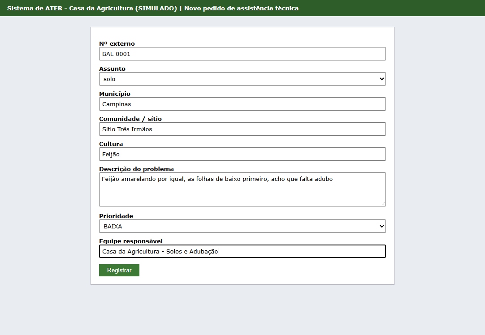
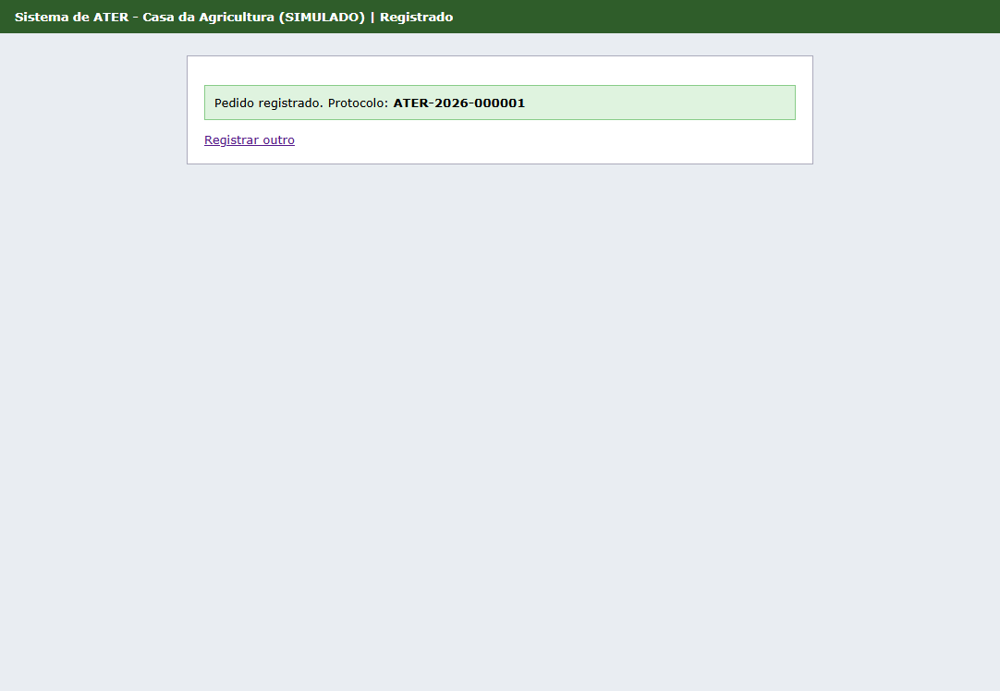
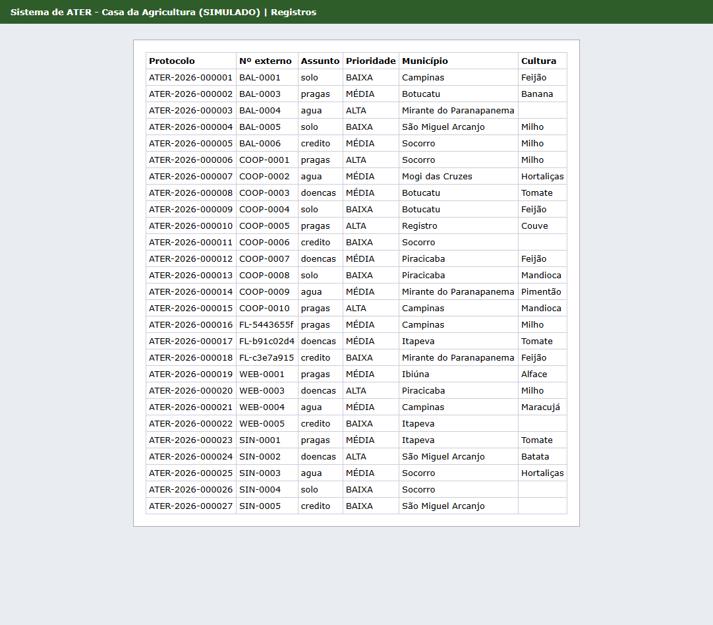
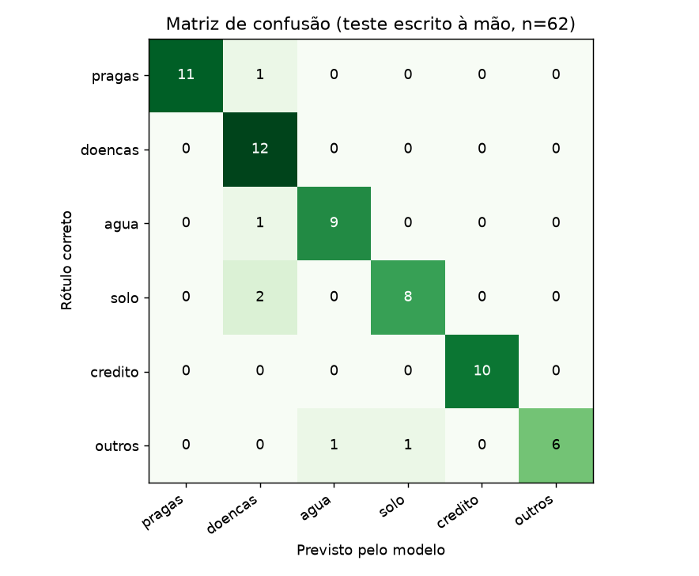

# Evidências de validação

Todos os resultados são reproduzíveis pelos comandos indicados. Arquivos de apoio em [evidencias/](evidencias/).

## 1. Execução de ponta a ponta

**Comando:** `python main.py reset` e `python main.py`

**Entrada:** 6 arquivos sintéticos ([dados/gerar_dados.py](../dados/gerar_dados.py)) com problemas inseridos de propósito.

| Arquivo | Canal | Formato | Registros | Problemas inseridos |
| :- | :- | :- | :- | :- |
| `fala_lavoura_fila_tecnico.jsonl` | Fila do técnico do Fala, Lavoura! (GenAI) | JSONL, data `dd/mm/aaaa` | 6 | última linha cortada no meio; intoxicação; 2 perguntas fora do escopo |
| `cooperativa_whatsapp.csv` | WhatsApp da cooperativa | CSV, UTF-8, vírgula | 12 | linha duplicada; município e coordenada inválidos; telefone no texto |
| `casa_agricultura_balcao.csv` | Balcão da Casa da Agricultura | CSV, CP1252, ponto e vírgula | 7 | data no futuro; descrição "oi" |
| `sindicato_rural_lote.xlsx` | Sindicato rural | Excel | 7 | 2 pedidos fora do escopo |
| `formulario_site.json` | Site | JSON | 5 | CPF no texto; criança intoxicada |
| `exportacao_interrompida.json` | | JSON | ilegível | arquivo cortado no meio |

**Resultado** ([log](evidencias/log_execucao_limpa.txt), [relatório JSON](evidencias/execucao_exemplo.json), [planilha](evidencias/relatorio_exemplo.xlsx), [retorno ao Fala, Lavoura!](evidencias/retorno_fala_lavoura_exemplo.jsonl)):

| Indicador | Valor |
| :- | :- |
| Registros lidos | 37 |
| Registrados no sistema de ATER | 27 |
| Revisão do técnico | 6 (2 emergências de saúde, 2 fora do escopo classificados como "outros", 2 com confiança baixa) |
| Rejeitados | 3 (localização inválida, data no futuro, descrição curta) |
| Duplicata ignorada | 1 |
| Quarentena | 1 arquivo; 1 linha do JSONL pulada |
| Pendentes | 0 |
| Dados pessoais mascarados | 2 (telefone, CPF) |
| Retornos ao Fala, Lavoura! | 6 (3 registradas, 3 em revisão) |
| Tempo | 19,3 s |

Prioridades dos 27 registrados: 6 ALTA, 12 MÉDIA e 9 BAIXA. O critério de clima foi acionado com a previsão real do dia: a requeima na batata (SIN-0002) subiu para ALTA porque havia 21 mm de chuva previstos em 3 dias.

**Comparação com gabarito.** Os 36 registros únicos foram rotulados em [gabarito_entrada.csv](../dados/teste/gabarito_entrada.csv) com a decisão esperada, o assunto e a urgência. O `python main.py avaliar` compara automaticamente ([detalhe por registro](evidencias/avaliacao_lote_entrada.csv)):

| Medida | Resultado |
| :- | :- |
| Automatizados no assunto certo | **27/27** (IC 95%: 87,5% a 100%) |
| Rejeições corretas | 3/3 |
| Fora do escopo ou emergência enviados ao técnico | 6/6 |
| Erros silenciosos | 0 |
| Pedidos do escopo enviados ao técnico sem necessidade | 0 |
| Urgentes detectados | 7/7, sem alarme falso |
| Fichas do Fala, Lavoura! com a decisão certa | 6/6 |

As duas suspeitas de intoxicação (a ficha `70537f0c` do Fala, Lavoura! e o WEB-0002) tinham confiança suficiente para o robô decidir sozinho (80% e 46%), mas foram para o técnico pela regra de emergência de saúde, com a mensagem de emergência para a família. Os intervalos usam o método de Wilson, adequado a amostras pequenas e taxas próximas de 100%.

| Formulário preenchido | Protocolo gerado | Registros no sistema |
| :-: | :-: | :-: |
|  |  |  |

## 2. Modelo em conjunto de teste rotulado

**Comando:** `python main.py avaliar` · **Amostra:** [teste_rotulado.csv](../dados/teste/teste_rotulado.csv), 62 frases escritas à mão, com vocabulário diferente do treino (54 no escopo, 8 fora).

Na validação cruzada do treino o F1 é 0,98, sinal de que as frases sintéticas são parecidas demais entre si. Por isso o teste é separado e escrito de outra forma.

### 2.1 Classificador (54 frases do escopo)

| | Acurácia | F1 macro |
| :- | :-: | :-: |
| **Dicionário da Roça + TF-IDF + Regressão Logística** | **92,6%** (IC 95%: 82,4% a 97,1%) | **0,930** |
| Mesmo modelo sem o Dicionário da Roça | 88,9% | 0,900 |
| Regra por palavra-chave | 38,9% | 0,522 |

A regra por palavra-chave não respondeu 28 das 54 frases ("bichinhos verdes", "pó branco parecendo farinha", "DAP", "barraginha"). O Dicionário da Roça mudou duas respostas, as duas para o certo: "Minha DAP venceu, como faço o CAF novo?" (sem ele, "outros") e "Quero um empréstimo pra comprar um trator pequeno" (sem ele, "pragas").

| Assunto | Precisão | Recall | F1 | n |
| :- | :-: | :-: | :-: | :-: |
| pragas | 1,00 | 0,92 | 0,96 | 12 |
| doenças | 0,75 | 1,00 | 0,86 | 12 |
| água | 1,00 | 0,90 | 0,95 | 10 |
| solo | 1,00 | 0,80 | 0,89 | 10 |
| crédito | 1,00 | 1,00 | 1,00 | 10 |

### 2.2 Robô com limiar de confiança (62 frases)

Erro silencioso é quando o robô decide sozinho e erra, o pior caso, porque ninguém revisa. Um pedido só é automatizado se a confiança passar do limiar **e** o assunto previsto não for "outros".

| Limiar | Automatiza | Acerto no automatizado | Erros silenciosos | Fora do escopo retidos |
| :-: | :-: | :-: | :-: | :-: |
| 0,30 | 90,3% | 89,3% | 6 | 6/8 |
| 0,35 | 87,1% | 92,6% | 4 | 7/8 |
| **0,40** | **83,9%** | **94,2%** | **3** | **8/8** |
| 0,50 | 71,0% | 93,2% | 3 | 8/8 |
| 0,55 | 66,1% | 92,7% | 3 | 8/8 |
| 0,65 | 50,0% | 96,8% | 1 | 8/8 |

**Regra de escolha** (a mesma do projeto anterior do grupo): o limiar com maior acerto no automatizado, mantendo pelo menos 65% de automação. Com todos os dados, a regra escolhe 0,40. Acima disso, o robô manda mais acertos para o técnico sem reduzir os erros silenciosos até 0,60.

**Estimativa sem viés de seleção.** Escolher o limiar e medir o resultado nos mesmos dados infla o número. Por isso o teste foi dividido em 5 partes: em cada rodada, a regra escolhe o limiar em 4 partes e o resultado é medido só na parte que ficou de fora.

| Validação cruzada aninhada | Resultado |
| :- | :- |
| Limiar escolhido em cada rodada | 0,40; 0,35; 0,40; 0,40; 0,40 |
| Automatizadas | 85,5% |
| Acerto no automatizado | **92,5%** (IC 95%: 82,1% a 97,0%) |
| Erros silenciosos | 4 |

A estimativa honesta fica no mesmo patamar da medição direta (94,2%), o que indica que o 0,40 não foi um ajuste de sorte.

### 2.3 Regra de urgência

No teste escrito à mão: recall de 0,75 (3/4) e precisão de 0,75 (3/4). No lote de entrada: 7/7, sem alarme falso. A amostra de urgentes no teste é pequena demais para conclusões fortes.

## 3. Falhas tratadas

**Comando:** `python main.py falhas` ([resultado](evidencias/demo_falhas.md))

| Cenário | Falha simulada | Resultado |
| :- | :- | :- |
| API de clima fora do ar | host inexistente | 22/22 pedidos de lavoura seguem sem o critério de clima, com justificativa; disjuntor abre após 2 falhas |
| Sistema de ATER fora do ar | sistema desligado | 27 pedidos na fila de pendentes |
| Sistema instável | erro 503 a cada 4 cadastros | 27/27 registrados após 8 novas tentativas automáticas |
| Senha errada | `PORTAL_SENHA` inválida | 2 pendentes; registrados após corrigir a senha |
| Arquivo corrompido | JSON cortado | quarentena com motivo; demais arquivos lidos |
| Linha quebrada no JSONL | última ficha do Fala, Lavoura! cortada | só a linha é pulada; as 6 fichas válidas seguem |
| Arquivo ausente | caminho inexistente | registrado no log; execução concluída |
| Dados inválidos | data futura, "oi", município inexistente, duplicata | 3 rejeições com motivo e mensagem; duplicata ignorada |
| Execução repetida | mesmos arquivos | nenhum cadastro em dobro |
| Reenvio corrigido | pedido rejeitado volta com descrição completa | reenvio processado e registrado |

Todos os 10 cenários passaram. Os 34 testes automatizados (`python -m pytest`) cobrem validação, mascaramento, formatos de município e de data, leitura em CP1252, JSON corrompido, fila do Fala, Lavoura! com linha quebrada, Dicionário da Roça, retry, geada, calor sem chuva, chuva e fungo, semáforo da GenAI, prazo de programa, emergência de saúde, API fora do ar, arquivo de estado bloqueado, reenvio corrigido e o arquivo de retorno. Eles também rodam no GitHub Actions a cada push.

## 4. Análise dos erros

Erros em [avaliacao_erros.csv](evidencias/avaliacao_erros.csv).

| Frase | Esperado | Previsto | Foi ao técnico? | Causa |
| :- | :- | :- | :-: | :- |
| "Ácaro deixando a folha do morango com cara de ferrugem e uma teia fininha" | pragas | doenças (75%) | não | "ferrugem" é palavra forte de doença; "ácaro" aparece pouco no treino |
| "Terreno encharca e o pé de mandioca apodrece de tanto molhado" | água | doenças (62%) | não | "apodrece" puxa para doença; a causa (encharcamento) é de água |
| "O milho nasceu fraquinho e amarelado, as folhas de baixo secando na ponta" | solo | doenças (59%) | não | "secando" está nos templates de doença, e "amarelado" não está no Dicionário da Roça (só "amarelada" e "amarelando") |
| "O capim não cresce mais no pasto, acho que o chão tá pobre" | solo | doenças (33%) | sim | "pasto" e "chão pobre" não aparecem no treino |
| "A luz cai toda vez que venta no sítio" | fora do escopo | água (38%) | sim | o modelo não reconhece "luz" como energia elétrica |
| "Quero denunciar o vizinho que mudou a cerca de lugar" | fora do escopo | solo (35%) | sim | assunto sem nenhuma palavra parecida no treino |

Os três erros silenciosos vão todos para "doenças" (precisão de 0,75): palavras de sintoma (podre, secando, ferrugem) aparecem em várias causas, e só um técnico distingue praga, água ou nutrição pelo sintoma. Uma melhoria seria mandar ao técnico, mesmo com confiança alta, os casos de "doenças" que têm uma segunda opção forte.

Entre as palavras de maior peso estão algumas vazias, como "com", "ta" e "pra": os templates de treino repetem construções e o modelo aprende o vício, um caso de GIGO no próprio treino.

Na urgência, a regra perdeu "devorando o feijão do assentamento inteiro" (procura "lavoura inteira", não "assentamento inteiro") e deu alarme a mais em "já vi isso ano passado e perdi tudo" (a perda foi no passado). Regras por palavra-chave só detectam o que foi previsto.

## 5. Primeira rodada e o que mudou

A primeira versão do modelo, sem a classe "outros" e com templates mais pobres, teve 87,0% de acurácia no teste e só reteve 4 de 8 pedidos fora do escopo ("festa do padroeiro" e "ponte caiu" passavam como crédito e "curso de tratorista" como pragas, com 55% a 67% de confiança). No lote de entrada ela deixou passar 1 erro silencioso (bomba do gotejo queimada → doenças, porque o Dicionário da Roça traduz "queimou" como "requeima") e mandou 4 pedidos do escopo para o técnico.

Mudanças feitas depois dessa rodada:

1. **Classe "outros"** no treino, com pedidos de estrada, energia, documento pessoal, festa, saúde e animais domésticos (frases diferentes das do teste).
2. **Vocabulário ampliado nos templates:** veneno e bomba costal em pragas, bomba d'água queimada em água, perda de safra em crédito, pó alaranjado e pústulas em doenças.
3. **Limiar** recalculado pela mesma regra fixa: de 0,55 para 0,40.

Como essas mudanças vieram depois de ver os erros, os números do teste e do lote podem estar otimistas. A validação cruzada aninhada protege só a escolha do limiar, não a escolha dos templates.

## 6. Limites

1. **Amostras pequenas** (62 frases de teste, 36 registros de entrada): os intervalos de confiança são largos.
2. **Rotulagem e escrita pela mesma equipe:** teste e gabarito foram escritos e rotulados por quem construiu o modelo, e os templates foram ajustados depois de ver os erros; um rotulador independente e textos reais reduziriam esse viés.
3. **Treino sintético:** F1 de 0,98 no treino contra 0,93 no teste.
4. **Regras de urgência por palavra-chave:** explicáveis, mas limitadas.
5. **Clima no centro do município:** a geada não aconteceu na execução real (novembro); está coberta por teste automatizado com mínima de 1,5 °C.
6. **Sistema simulado:** seletores e tempos mudariam num sistema real. A execução completa foi validada com o Chrome.
