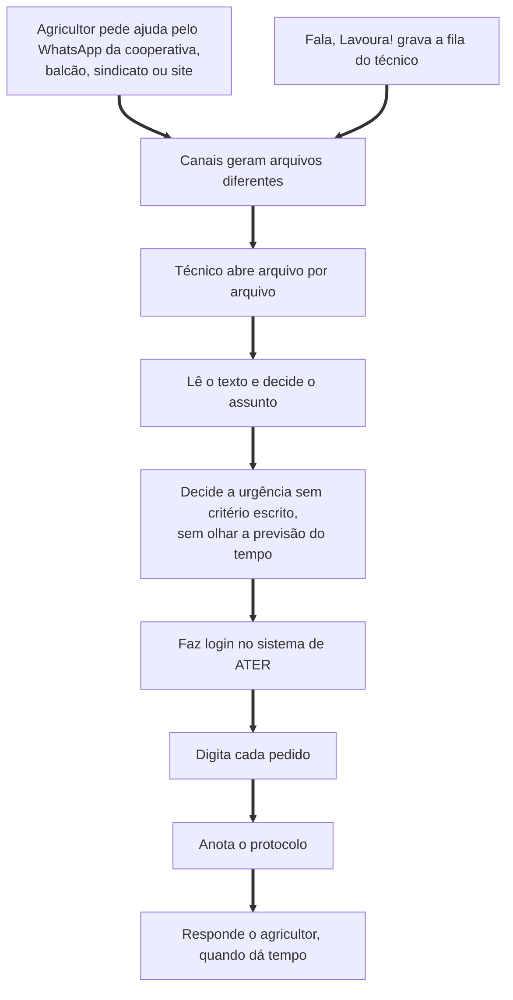
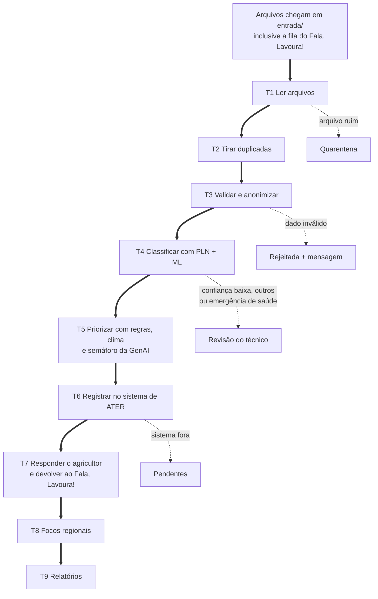

# Processo: AS-IS e TO-BE

Etapas do BPM: identificar → modelar → analisar → otimizar → automatizar → monitorar.

## 1. Identificar

**Processo:** atender um pedido de assistência técnica rural, do pedido do agricultor ao protocolo com equipe e prazo.
**Participantes:** agricultor familiar, Fala, Lavoura! (assistente de IA generativa), técnico da triagem na Casa da Agricultura e equipe de campo responsável.

## 2. AS-IS

## 3. Análise

| Tarefa | Problema | Tipo |
| :- | :- | :- |
| Abrir arquivos dos canais | Formatos, encodings e duplicatas | Repetitiva, baseada em regra |
| Entender o assunto | Texto falado ("bicho comendo a folha"), lento e inconsistente entre técnicos | Repetitiva, exige interpretar texto |
| Priorizar | Sem critério; intoxicação e geada chegando na fila comum | Baseada em regra, se ela existir |
| Digitar no sistema | Cópia manual, erros e horas fora do campo | Repetitiva, baseada em regra |
| Responder o agricultor e o Fala, Lavoura! | Frequentemente não ocorre; a ficha fica "aguardando técnico" para sempre | Repetitiva |
| Casos ambíguos, fora do escopo e emergências | Exigem julgamento ou um telefonema | Não automatizável |

Quase tudo é repetitivo e baseado em regras, exceto interpretar o texto livre (PLN) e decidir casos ambíguos ou de saúde (pessoas). Faltava também uma regra explícita de prioridade que considerasse o clima.

## 4. TO-BE

Mudanças:

1. **Entrada unificada** numa pasta, com leitura de todos os formatos, incluindo a fila do Fala, Lavoura!.
2. **Prioridade explicável:** assunto + risco + semáforo da GenAI + pedido repetido + prazo de programa + previsão de 3 dias (geada, calor sem chuva, chuva que favorece fungo), sempre com justificativa.
3. **Técnico na revisão, não na digitação:** só os casos incertos, fora do escopo ou de emergência, com os urgentes no topo.
4. **Todo agricultor recebe resposta,** inclusive rejeitados e pendentes. Em caso de intoxicação, a mensagem já traz o SAMU e o Disque-Intoxicação.
5. **O ciclo com a GenAI fecha:** cada ficha do Fala, Lavoura! recebe de volta protocolo, equipe e prazo.
6. **Nada se perde:** cada falha tem fila própria.

## 5. Automatizar: tarefas e relações

| Tarefa | Depende de | Arquivo | Em caso de falha |
| :- | :- | :- | :- |
| T1 Ler arquivos | pasta `entrada/` | `leitura.py` | quarentena (arquivo) ou pula a linha (JSONL) |
| T2 Tirar duplicadas | T1 | `pipeline.py` | ignora e contabiliza |
| T3 Validar e anonimizar | T2 | `validacao.py` | rejeitadas |
| T4 Classificar | T3 | `modelo.py` | revisão do técnico |
| T5 Priorizar | T4 | `prioridade.py` | segue sem o critério de clima |
| T6 Registrar | T5 | `rpa_portal.py` | pendentes |
| T7 Responder agricultor e Fala, Lavoura! | T3, T4 ou T6 | `pipeline.py` | mensagem sempre gerada; erro no arquivo de retorno vai para o log |
| T8 Focos regionais | T6 | `modelo.py` | pula com poucos dados |
| T9 Relatórios | todas | `relatorio.py` | JSON se o Excel falhar |

## 6. Monitorar

Cada execução registra lidos, registrados, revisões, rejeições, pendentes, retornos ao Fala, Lavoura!, tempo e memória na aba Resumo e no JSON de execução. Na execução de referência, 27 pedidos foram registrados em cerca de 20 segundos, e o trabalho do técnico caiu de 37 pedidos para 6. O tempo do processo manual não foi medido, por isso não há comparação numérica de ganho.
